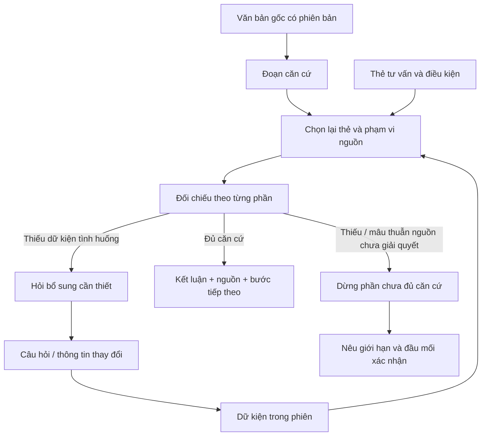

# Báo cáo tiến độ 02 — thiết kế chatbot tư vấn thủ tục theo tình huống

**Đề tài:** Chatbot tư vấn thủ tục cho Ban Khoa học–Công nghệ (KHCN), Ban Tài chính–Kế hoạch (TCKH) và Ban Tổ chức–Nhân sự (TCNS) tại HUST.

**Phạm vi báo cáo:** kết quả khảo sát, lựa chọn nội dung và đặc tả thiết kế; chưa có chương trình demo hoặc kết quả thực nghiệm. Trọng tâm là thiết kế chức năng tư vấn; kết quả demo sẽ được bổ sung sau khi triển khai và kiểm tra.

## 1. Mục tiêu và kết quả kỳ này

Khi cán bộ hỏi về một hoạt động nghiên cứu, công tác hoặc đào tạo, câu trả lời phụ thuộc vào loại việc, đơn vị, thời điểm và nguồn kinh phí. Ý định thiết kế là để chatbot **làm rõ tình huống, áp dụng đúng điều kiện của các nguồn liên quan và giữ hướng dẫn nhất quán khi người hỏi thay đổi thông tin**. Câu trả lời phải kiểm tra được căn cứ, đồng thời phân biệt thông tin người dùng cung cấp với dữ kiện đã xác minh.

| Nội dung | Kết quả hiện có | Trạng thái |
|---|---|---|
| Căn cứ định hướng | Đã đối chiếu hai tài liệu người hướng dẫn cung cấp với phạm vi chatbot hiện tại. | Khảo sát tài liệu, không thay xác nhận quy định gốc. |
| Phạm vi và chức năng | Đã xác định năm năng lực F01–F05 và giới hạn dữ liệu/thẩm quyền. | Đặc tả chức năng. |
| Nội dung ban đầu | Đã chọn năm thẻ từ tài liệu nguồn để đặc tả trước; có nội dung cho cả ba Ban và các điểm giao quy định. | Danh mục đề xuất, chưa phải toàn bộ thẻ đã duyệt. |
| Tổ chức tri thức | Đã thiết kế cấu trúc thẻ, liên kết nguồn–điều kiện–kết luận và dữ kiện phiên hội thoại. | Thiết kế trên tài liệu, chưa cài đặt. |
| Đánh giá | Đã xác định cấu hình đối chứng, loại ca thử và cách chấm từng năng lực. | Phương án đánh giá, chưa có số đo. |
| Kịch bản trình diễn | Đã hoàn thành thiết kế kịch bản T6 và bảng tiêu chí CA-01. | Thiết kế đã lập; chưa triển khai/chạy nguyên mẫu. |

## 2. Cơ sở lựa chọn nội dung

Hai tài liệu định hướng có vai trò khác nhau:

- **Tài liệu gợi ý hai Ban** đề xuất chuẩn hóa thủ tục thành thẻ, xác định đầu mối, nguồn và giới hạn câu trả lời; lưu ý nhiều hướng dẫn/biểu mẫu gốc còn cần bổ sung.
- **Bộ nội dung ba miền** có 28 nhóm ý định, 12 thẻ thủ tục, 42 câu hỏi–đáp, 17 tình huống cần xử lý thận trọng và bốn kịch bản hội thoại. Đây là nguyên liệu để chọn nội dung và dựng ca kiểm thử, không phải 12 thẻ đã được sản phẩm này chuẩn hóa hoặc 42 đáp án đã nghiệm thu.

Các nội dung tuyển dụng, tính kNC/đánh giá cá nhân, tra dữ liệu lương thực nhận, tự duyệt và xử lý hồ sơ thật được loại khỏi phạm vi. Các điểm mơ hồ do tài liệu phân tích nêu phải đối chiếu lại văn bản gốc; không tự chọn một cách hiểu rồi đưa vào bộ quy tắc chính thức.

### Danh mục đặc tả ban đầu

Mã T1, T3, T4, T6, T10 bên dưới được giữ theo bộ nội dung nguồn để đối chiếu. Trong sản phẩm, chúng được chuẩn hóa thành **thẻ tư vấn**, không phải mã quy trình tự động hóa.

Năm thẻ được ưu tiên vì có các nhánh điều kiện để kiểm tra việc hỏi bổ sung, có điểm giao giữa các nguồn và đại diện cho phạm vi tư vấn của ba Ban. T1/T3/T4 cung cấp các tình huống điều kiện và thời điểm; T6/T10 cung cấp các tình huống cần đối chiếu nhiều miền. Đây là lựa chọn phục vụ đặc tả và thử nghiệm, chưa phải xếp hạng theo tần suất câu hỏi thực tế.

| Thẻ nguồn | Phần tư vấn được chọn | Miền và điểm giao | Phần không thực hiện |
|---|---|---|---|
| **T1 — Đăng ký nhiệm vụ** | Điều kiện theo loại nhiệm vụ; thông tin cần làm rõ; hướng dẫn hồ sơ, nguồn và đầu mối đăng ký. | KHCN; chỉ mở phần tài chính khi nguồn và câu hỏi thực sự cần. | Không xét chọn, chấm thuyết minh, tiếp nhận hoặc nộp hồ sơ. |
| **T3 — Điều chỉnh/gia hạn** | Trường hợp cần điều chỉnh; điều kiện, mốc và hướng dẫn theo thay đổi được người hỏi khai báo. | KHCN; TCKH khi hỏi quy định kinh phí; liên hệ T10 khi người đi đào tạo/nghiên cứu đang chủ nhiệm nhiệm vụ. | Không đổi chủ nhiệm, điều phối hồ sơ, duyệt gia hạn hoặc sửa dự toán. |
| **T4 — Nghiệm thu** | Hướng dẫn yêu cầu, mốc, thành phần hồ sơ và nguồn liên quan; nêu điểm chưa thống nhất để xác nhận. | KHCN và đơn vị chủ trì theo nguồn được duyệt. | Không kiểm tra bộ hồ sơ thật, chấm sản phẩm hoặc quyết định nghiệm thu. |
| **T6 — Hội thảo/công tác bằng kinh phí nhiệm vụ** | Xác định quy định tài chính và nhiệm vụ cần đối chiếu; hướng dẫn định mức, thành phần chứng từ và thời hạn ở mức quy tắc. | KHCN–TCKH; không mặc định thuộc phạm vi cử đi đào tạo của TCNS. | Không tính/xác nhận khoản được chi thật, thẩm định chứng từ hoặc thực hiện thanh toán. |
| **T10 — Cử đi đào tạo/nghiên cứu** | Điều kiện, thời gian, nghĩa vụ; điều kiện chung của hỗ trợ đào tạo; điểm cần xem lại khi đang tham gia nhiệm vụ. | TCNS; TCKH theo phần hỗ trợ; KHCN theo phần nhiệm vụ, chỉ ghép nguồn khi có căn cứ. | Không ban hành quyết định cử đi, tra hồ sơ nhân sự/sinh viên hoặc xác nhận chế độ thực nhận. |

**Nguyên tắc mở rộng:** năm thẻ trên là tập đặc tả đầu tiên. Khoảng 12 thẻ chỉ là ước lượng để tham khảo khi lập phạm vi cuối, không phải số lượng bắt buộc. Nội dung được mở rộng khi có nhóm câu hỏi chưa được bao phủ, nguồn có thể kiểm chứng và điều kiện đánh giá tương ứng. Các điều kiện dùng chung được tái sử dụng; số nhánh hỏi không đại diện cho số quy trình.

Phạm vi nguồn được xác định theo yêu cầu của từng tình huống; câu hỏi một Ban và giao Ban đều được hỗ trợ. Thông tin cán bộ cung cấp khi đang học sau đại học chỉ phục vụ tình huống tư vấn, không yêu cầu truy xuất hồ sơ sinh viên.

## 3. Vì sao tổ chức theo thẻ tư vấn?

“Thẻ” là **đơn vị tri thức có cấu trúc cho một mục đích tư vấn**. Nó không phải đáp án cố định, một đoạn văn được cắt từ PDF hay biểu mẫu nhập liệu cho người dùng.

| Cách tổ chức | Vai trò | Giới hạn nếu chỉ dùng riêng |
|---|---|---|
| **Văn bản gốc/đoạn căn cứ** | Giữ nội dung nguồn, vị trí trích dẫn và bằng chứng cho câu trả lời. | Một đoạn tìm được có thể thiếu điều kiện ở điều khác; ngày hiệu lực và đối tượng áp dụng cần được đối chiếu. |
| **Thẻ tư vấn** | Tập hợp câu hỏi được hỗ trợ, dữ kiện quyết định, điều kiện, nguồn, điểm dừng và đầu mối cho cùng mục đích. | Không thay quy định gốc; nội dung suy diễn hoặc chưa xác minh không được biến thành quy tắc chính thức. |
| **Dữ kiện phiên hội thoại** | Ghi thông tin người dùng đang cung cấp và các thay đổi; chỉ rõ dữ kiện nào là khai báo/chưa xác minh. | Là đầu vào tư vấn, không tự đồng bộ hoặc trở thành hồ sơ/quyết định chính thức của HUST. |

Lựa chọn này phục vụ ba mục đích:

1. **Hỏi đúng dữ kiện:** thẻ chỉ ra biến nào có thể làm thay đổi hướng dẫn, giúp tránh hỏi đủ mọi trường của một thủ tục.
2. **Đối chiếu và dùng lại:** một tình huống có thể kích hoạt nhiều thẻ; một đoạn quy định có thể được nhiều thẻ tham chiếu. Không sao chép cùng quy tắc vào nhiều đáp án độc lập rồi để chúng lệch nhau.
3. **Kiểm tra và cập nhật:** có thể kiểm lại kết luận theo nguồn và dữ kiện đã dùng; khi một phiên bản nguồn hoặc dữ kiện đổi, xác định phần cần rà soát thay vì giữ nguyên đáp án cũ.

Thẻ là phương án tổ chức nội dung được tài liệu định hướng đề xuất. Đóng góp cần kiểm chứng của đề tài nằm ở cách hỏi bổ sung và duy trì kết luận nhất quán, không phải tuyên bố việc dùng thẻ là ý tưởng chưa từng có.

### Cấu trúc một thẻ đề xuất

| Nhóm trường | Nội dung cần lưu | Mục đích |
|---|---|---|
| **Nhận diện và phạm vi** | Mã, tên, mục đích tư vấn, chủ nội dung, Ban/nguồn liên quan, câu hỏi hỗ trợ và phần loại trừ. | Chọn đúng nội dung; không kéo câu hỏi sang nghiệp vụ khác. |
| **Dữ kiện quyết định** | Đối tượng, loại hoạt động/nhiệm vụ, đơn vị, thời điểm, nguồn kinh phí và các biến thực sự cần cho nhánh đang xét. | Chỉ thu thập thông tin cần thiết để xác định hướng dẫn phù hợp. |
| **Điều kiện và liên kết** | Điều kiện cần kiểm; kết luận phụ thuộc dữ kiện nào; thẻ/điều kiện dùng chung. | Kiểm tra nhất quán và kiểm lại khi dữ kiện thay đổi. |
| **Bằng chứng nguồn** | Tệp/đường dẫn, điều–khoản/bảng/đoạn, phiên bản, phạm vi, mốc hiệu lực, quan hệ thay thế và trạng thái xác minh. | Giải thích kết luận, lọc đúng mốc áp dụng và dừng khi nguồn chưa rõ. |
| **Kết quả và điểm dừng** | Mẫu cấu trúc câu trả lời, ba mức kết luận điều kiện, nội dung còn thiếu và đầu mối cần xác nhận. | Phân biệt thông tin cung cấp với xác nhận chính thức; hướng dẫn đầu mối phụ trách. |
| **Kiểm chứng nội dung** | Người kiểm tra, ca thử và nhận xét; phần nào đang dự thảo/chưa đủ nguồn. | Tách tài liệu thiết kế khỏi nội dung đã được xác nhận. |

Việc kiểm tra thẻ là quản trị chất lượng nội dung. Nó không tạo thêm luồng hành chính xin duyệt hoặc chức năng phê duyệt hồ sơ cho chatbot.

### Mẫu thiết kế thẻ T6

**Trạng thái:** mẫu đặc tả để triển khai, chưa phải nội dung nghiệp vụ đã được xác nhận. Các văn bản dưới đây là những nguồn cần đối chiếu theo chỉ dẫn ở T6 và kịch bản 3 trong tài liệu [2]; không mặc định đã có đầy đủ bản gốc hoặc đã xác minh hiệu lực.

| Trường | Đặc tả mẫu |
|---|---|
| **Mã, tên, mục đích** | T6 — Tư vấn quy định áp dụng cho hội thảo/công tác bằng kinh phí nhiệm vụ; giúp người hỏi xác định các điều kiện, nguồn và đầu mối cần đối chiếu. |
| **Phạm vi** | Câu hỏi hướng dẫn KHCN–TCKH. Loại trừ tiếp nhận hồ sơ, thẩm định chứng từ, xác nhận khoản chi và thanh toán. |
| **Dữ kiện cần xét** | Loại hoạt động; trong nước/nước ngoài; thời điểm; nguồn hỗ trợ là nhiệm vụ, đơn vị hay kết hợp. Chỉ hỏi loại nhiệm vụ, đặc điểm đơn vị hoặc tham số bổ sung nếu nguồn cho thấy chúng làm thay đổi hướng dẫn. |
| **Nguồn cần đối chiếu** | Quy định nhiệm vụ KHCN, phần kinh phí và phụ lục liên quan; Quy chế Chi tiêu nội bộ, phần công tác/hội thảo và thời hạn; văn bản được dẫn chiếu và quy định đơn vị nếu áp dụng. Chỉ dẫn trong tài liệu [2]: Điều 14/Phụ lục II của quy định nhiệm vụ, Điều 16/24 của quy chế chi tiêu. Vị trí và hiệu lực phải kiểm tra lại trên bản gốc. |
| **KL1 — Phạm vi nguồn** | Việc áp dụng quy định dành cho kinh phí nhiệm vụ phụ thuộc nguồn hỗ trợ và quan hệ của hoạt động với nhiệm vụ. |
| **KL2 — Điều kiện tài chính cần đối chiếu** | Phụ thuộc loại hoạt động, địa điểm, thời điểm, nguồn và phạm vi đơn vị. Chỉ giải thích điều kiện có căn cứ, không kết luận khoản thực tế được chi. |
| **KL3 — Phần cần xác nhận** | Phụ thuộc mức đầy đủ và thống nhất của các nguồn; ghi rõ điều kiện nào còn thiếu căn cứ và đầu mối cần trao đổi. |
| **Khi dữ kiện đổi** | Xét lại thẻ và nguồn đang áp dụng trước, sau đó kiểm KL1–KL3. Nếu nguồn đơn vị thay thế hoàn toàn nguồn nhiệm vụ, ngừng dùng kết luận chỉ dành cho kinh phí nhiệm vụ; kiểm lại phần quy định chung còn liên quan. Nếu là nguồn kết hợp, làm rõ phạm vi từng nguồn thay vì tự coi là thay thế. |
| **Điểm hỏi bổ sung** | Thiếu dữ kiện tình huống mà nguồn đã xác nhận cho thấy có ảnh hưởng: hỏi người dùng và ghi nhận thông tin cung cấp. |
| **Điểm dừng** | Thiếu bản nguồn/hiệu lực, mâu thuẫn chưa có căn cứ giải quyết hoặc cần xác nhận chính thức: nêu phần chưa kết luận, giữ phần đã đủ căn cứ và cung cấp tóm tắt cho đầu mối phụ trách. |
| **Đầu ra** | Hướng dẫn theo từng phần, dữ kiện đã dùng, KL1–KL3 tương ứng, đoạn căn cứ, phần chưa xác minh và bước tiếp theo. |

KL1–KL3 là các nhóm kết luận phục vụ thiết kế, không phải kết luận đã được xác lập cho một ca HUST. Mẫu này không điền trước hạn mức hay cách xử lý phần khoán khi nguồn còn cần xác nhận.

## 4. Ý định thiết kế hệ thống và hội thoại

Nhánh hỏi bổ sung dùng để làm rõ **tình huống của người dùng**. Nhánh dừng dùng khi thiếu **căn cứ để áp dụng quy định**, kể cả khi dữ kiện tình huống đã đầy đủ. Thông tin người dùng cung cấp không tự giải quyết được mâu thuẫn quy định; tài liệu bổ sung phải được kiểm tra nguồn và hiệu lực trước khi sử dụng. Các phần đã đủ căn cứ vẫn được trả lời riêng.

### Phân công thành phần

- **Mô hình ngôn ngữ:** hiểu cách diễn đạt, đề xuất miền/thẻ và dữ kiện từ câu hỏi, diễn đạt câu hỏi bổ sung và câu trả lời. Thông tin trích xuất còn mơ hồ phải hỏi lại; không tự suy ra trạng thái cá nhân/hồ sơ.
- **Truy xuất nguồn:** tìm đoạn liên quan trong tập được phép theo đối tượng, thời điểm và phiên bản; giữ vị trí nguồn. Nếu có tài liệu nội bộ, kiểm soát quyền trước truy xuất và hiển thị.
- **Bộ kiểm tra điều kiện:** đối chiếu dữ kiện với những điều kiện đã được xác nhận, kiểm tra thiếu/mâu thuẫn và xác định kết luận phụ thuộc. Không để mô hình ngôn ngữ tự đặt quy tắc thay văn bản.
- **Trạng thái phiên:** lưu giá trị hiện tại, nguồn gốc dữ kiện và kết luận đang dùng; khi thông tin đổi, kích hoạt lựa chọn lại thẻ/nguồn và kiểm tra các kết luận phụ thuộc. Đây là trạng thái tư vấn, không phải trạng thái hồ sơ nghiệp vụ.
- **Giao diện:** hội thoại là chính; người dùng mở được dữ kiện đang sử dụng và đoạn căn cứ của từng kết luận. Có thể hỏi tiếp hoặc sửa thông tin bằng ngôn ngữ tự nhiên, không bắt thao tác trên nhiều biểu mẫu.

Chưa cố định nhà cung cấp mô hình hoặc kiến trúc nhiều agent. Các lựa chọn đó phải phục vụ chất lượng và khả năng kiểm thử, không được dùng để tăng độ phức tạp hình thức.

### Luồng xử lý dự kiến

1. Nhận câu hỏi, nhận diện mục đích và kiểm tra phạm vi; giải thích giới hạn nếu ngoài nội dung hỗ trợ.
2. Chọn thẻ và nguồn theo dữ kiện hiện tại, đối tượng, thời điểm và trạng thái nguồn. Phân biệt khác biệt do phạm vi áp dụng với mâu thuẫn thực sự trong cùng trường hợp.
3. Với nguồn đã xác định được điều kiện áp dụng, chỉ hỏi dữ kiện còn thiếu có thể làm thay đổi hướng dẫn. Những dữ kiện không ảnh hưởng tới kết quả không cần thu thập.
4. Nếu bản nguồn, hiệu lực hoặc cách giải quyết mâu thuẫn chưa được xác minh, dừng ở phần liên quan và nêu căn cứ còn thiếu; không yêu cầu người dùng tự chọn cách hiểu quy định.
5. Đối chiếu điều kiện và trả kết luận theo từng phần, kèm dữ kiện, đoạn nguồn và bước tiếp theo.
6. Khi người dùng sửa thông tin, quay lại bước 2 để xét lại thẻ/nguồn, rồi kiểm các kết luận phụ thuộc; đánh dấu kết luận đã bị thay thế và giải thích phần thay đổi.
7. Khi cần xác nhận của đơn vị, cung cấp bản tóm tắt để người dùng trao đổi với đầu mối phụ trách. Hệ thống không tự tạo/gửi hồ sơ hoặc giao việc.

## 5. Năm năng lực và đầu ra dự kiến

| Năng lực | Hành vi phải thể hiện | Bằng chứng dự kiến khi có demo |
|---|---|---|
| **F01 — Hỏi bổ sung có mục đích** | Chỉ hỏi dữ kiện còn thiếu và có thể làm đổi đáp án; tránh hỏi lại hoặc hỏi thừa. | Các lượt hỏi so với bộ dữ kiện cần thiết đã gán cho ca. |
| **F02 — Đối chiếu giữa các Ban** | Áp dụng đúng nguồn cho từng phần cùng tình huống; phát hiện phần không tương thích, không suy ra tuyến xử lý giả định. | Các kết luận một Ban/giao Ban và đoạn nguồn hỗ trợ. |
| **F03 — Kiểm tra lại khi đổi dữ kiện** | Xét lại thẻ và nguồn đang áp dụng, rồi kiểm các kết luận phụ thuộc; nêu phần thay đổi, giữ phần còn đúng và đánh dấu kết luận đã thay thế. | Hội thoại trước/sau, tập thẻ/nguồn đã chọn và bảng kết luận bị ảnh hưởng. |
| **F04 — Phân biệt mức kết luận** | Với điều kiện cần xét: đáp ứng theo khai báo / không đáp ứng theo khai báo / chưa đủ căn cứ. Tách phần rõ và phần chưa rõ. | Ca đủ/không đủ dữ kiện, mâu thuẫn và cần xác nhận thực tế. |
| **F05 — Giải thích có thể kiểm tra** | Hiển thị dữ kiện, điều kiện, đoạn nguồn, phiên bản/mốc áp dụng và bước tiếp theo cho từng kết luận. | Người chấm kiểm tra được kết luận từ nguồn; không chỉ thấy đường link chung. |

Câu hỏi tra thông tin đơn giản đủ căn cứ được trả lời trực tiếp; áp dụng các bước cần thiết theo loại câu hỏi. Đầu vào không cần hồ sơ sinh viên, hồ sơ nhân sự đầy đủ hoặc sổ kế toán. Đầu ra là tư vấn và bản tóm tắt, không phải quyết định cử đi, phê duyệt điều chỉnh hoặc xác nhận khoản tiền.

## 6. Kịch bản dự kiến cho demo sau báo cáo

**Lựa chọn:** câu hỏi về hội thảo quốc tế bằng kinh phí nhiệm vụ, dựa trên T6 và kịch bản 3 trong bộ nội dung nguồn. Đây là thiết kế ca thử, chưa phải hội thoại do phần mềm chạy và chưa phải đáp án quy định đã nghiệm thu.

| Chặng | Thiết kế dự kiến | Năng lực quan sát |
|---|---|---|
| Câu hỏi ban đầu | Người dùng hỏi quy định áp dụng khi dự hội thảo bằng kinh phí nhiệm vụ. | Nhận diện phạm vi KHCN–TCKH. |
| Làm rõ | Bot hỏi dữ kiện mà nhánh quy định cần, chẳng hạn thời điểm, nguồn cụ thể hoặc loại hoạt động; không yêu cầu tên/MSSV hay hồ sơ cá nhân. | F01. |
| Hướng dẫn ban đầu | Tách phần quy định nhiệm vụ và phần hướng dẫn tài chính; chỉ dùng đoạn nguồn đã kiểm tra, nêu điểm còn thiếu. | F02, F04, F05. |
| Đổi thông tin | Người dùng đổi nguồn hỗ trợ sang kinh phí đơn vị. Bot xét lại thẻ và nguồn, làm rõ nguồn mới thay thế hay kết hợp, rồi kiểm các kết luận phụ thuộc. Phần cần quy định đơn vị chưa có được đánh dấu thiếu căn cứ. | F03, F05. |
| Điểm dừng | Khi nguồn xung đột hoặc thiếu hướng dẫn gốc, bot nêu phần chưa kết luận và đầu mối cần xác nhận. | F04. |

Không đưa số tiền cụ thể hay tự chọn một cách hiểu về phần khoán khi chưa kiểm tra nguồn gốc. Không dùng thẻ hội thảo để suy ra toàn bộ quy định cử cán bộ đi đào tạo. Nhánh người dùng thay đổi dữ kiện là phần thiết kế bổ sung của đề tài; không trình bày như nội dung đã có đầy đủ trong tài liệu thầy gửi.

## 7. Phương pháp và kế hoạch đánh giá

### Phương pháp triển khai

- Kiểm kê nguồn, phân loại văn bản gốc/tài liệu phân tích/dự thảo, xác minh phiên bản và hiệu lực; các điểm chưa rõ không được tự hoàn thiện bằng suy đoán.
- Chuẩn hóa từng thẻ theo cấu trúc đã thiết kế; liên kết điều kiện với nguồn và dữ kiện cần hỏi. Tình huống giả định được gắn nhãn riêng.
- Kết hợp truy xuất, kiểm tra điều kiện và trạng thái hội thoại; sau đó mới mở rộng tập chủ đề khi ca mẫu được kiểm chứng.

### Đối chứng

Ký hiệu **C0–C2** dành cho cấu hình thử nghiệm; mã T1/T3/T4/T6/T10 chỉ dành cho thẻ trong tài liệu nguồn.

- **C0:** hỏi đáp truy xuất cơ bản.
- **C1:** C0 bổ sung cơ chế hỏi làm rõ.
- **C2:** C1 bổ sung kiểm tra điều kiện, đối chiếu giao Ban và kiểm lại thẻ/nguồn/kết luận khi dữ kiện đổi.

Dùng cùng nguồn, mô hình nền, dữ kiện ban đầu và giới hạn xử lý. Khi hệ thống hỏi thêm, người thử dùng cùng bộ phản hồi chuẩn bị trước cho ca; ghi lại thông tin mỗi cấu hình thực sự đã nhận. Thay đổi tài liệu/điều kiện và thay đổi dữ kiện người dùng là hai loại thử nghiệm khác nhau, phải ghi riêng.

### Bộ ca và cách chấm

Bộ kiểm thử dự kiến gồm 120–150 ca, sẽ được xây dựng theo phạm vi được chốt cùng người hướng dẫn. 42 câu hỏi–đáp và 17 tình huống thận trọng trong tài liệu chỉ là tập ứng viên sau khi lọc phần ngoài phạm vi và xác nhận lại đáp án. Cần thêm ca hội thoại nhiều lượt và ca đổi dữ kiện để đánh giá F03.

Mỗi ca có câu hỏi, dữ kiện ban đầu, phản hồi khi được hỏi, nguồn/phiên bản đúng, các điều kiện cần xét, kết luận mong đợi và điểm phải dừng. Chuyên viên xác nhận bộ đáp án trước đánh giá cuối. Tách tập phát triển và tập kiểm thử theo tình huống gốc; các câu diễn đạt lại của cùng ca không được đặt ở cả hai tập và không được đếm thành các ca nghiệp vụ độc lập.

| Nội dung chấm | Cách ghi nhận |
|---|---|
| Đúng và đủ kết luận | So từng ý với đáp án và điều kiện áp dụng, tách một Ban/giao Ban. |
| Đúng căn cứ | Kiểm tra đoạn nguồn có thực sự hỗ trợ kết luận; vị trí và mốc áp dụng có đúng không. |
| Hỏi đúng | Ghi dữ kiện cần nhưng chưa hỏi, câu hỏi cần thiết và câu hỏi thừa. |
| Nhất quán khi đổi dữ kiện | Kiểm kết luận cuối, phần cũ phải thay và phần không nên thay. |
| Dừng đúng | Ghi kết luận vượt căn cứ, bỏ sót mâu thuẫn hoặc chuyển người dù đã đủ nguồn. |
| Hiệu năng và sử dụng | Đo thời gian phản hồi/hoàn thành tình huống; ghi cấu hình và điều kiện đo, chưa cam kết mức tiết kiệm. |

### Bảng chấm mẫu cho ca CA-01

**Trạng thái:** thiết kế tiêu chí chấm, chưa có kết quả chạy hoặc kết luận đạt. Ca chỉ được dùng để chấm nghiệp vụ sau khi các đoạn nguồn và đáp án được xác nhận.

- **Tình huống giả định:** người dùng hỏi quy định cho việc đi hội thảo bằng kinh phí nhiệm vụ nhưng chưa nêu địa điểm và thời điểm; sau lượt làm rõ, đổi sang kinh phí đơn vị thay thế hoàn toàn nguồn nhiệm vụ.
- **Nguồn dự kiến:** S-NV là đoạn quy định nhiệm vụ; S-CT là đoạn quy định công tác/hội thảo áp dụng chung; S-ĐV là quy định riêng của đơn vị. Trong biến thể thử này, giả định S-NV/S-CT đã được kiểm tra, còn S-ĐV chưa có trong tập nguồn. Đây là cách bố trí ca thử, không phải kết luận HUST thiếu văn bản.
- **Đáp án mong đợi về hành vi:** hỏi đúng dữ kiện cần thiết; giải thích riêng phần nhiệm vụ và tài chính theo nguồn; sau đổi thông tin, xét lại phạm vi áp dụng và dừng ở phần cần S-ĐV. Các nội dung và mốc cụ thể phải được người chấm gán theo nguồn thực tế, không tự điền trong báo cáo.

| Năng lực | Nội dung cần kiểm tra | Căn cứ đối chiếu khi chấm | Tiêu chí đạt khi thử nghiệm |
|---|---|---|---|
| **F01 — Hỏi bổ sung** | Địa điểm và thời điểm cần được làm rõ nếu chúng quyết định nhánh trong S-CT; chỉ hỏi thêm loại nhiệm vụ/đơn vị khi nguồn tương ứng đòi hỏi. | Danh sách dữ kiện cần thiết được gán từ S-NV/S-CT và thông tin đã có của ca. | Thu thập đủ dữ kiện làm đổi hướng dẫn, không hỏi lại thông tin đã có hoặc yêu cầu hồ sơ cá nhân không liên quan. Chấp nhận cách hỏi/thứ tự tương đương. |
| **F02 — Đối chiếu** | Kết luận về quy định nhiệm vụ tách được với phần hướng dẫn công tác/hội thảo. | Đoạn S-NV/S-CT, phạm vi áp dụng và đáp án từng phần đã xác nhận. | Các kết luận có đúng nguồn hỗ trợ; không dùng nguồn của một Ban để khẳng định phần chưa được nguồn đó quy định, không thêm TCNS nếu không liên quan. |
| **F03 — Đổi dữ kiện** | Khi nguồn đơn vị thay thế hoàn toàn nguồn nhiệm vụ, cần xét lại thẻ/nguồn và những kết luận chỉ dựa trên kinh phí nhiệm vụ. | Dữ kiện trước/sau, quan hệ KL1–KL3 và phần quy định chung còn áp dụng. | Loại hoặc đánh dấu đã thay thế kết luận không còn áp dụng; giữ phần vẫn có căn cứ; không chỉ đổi tên nguồn trong câu trả lời cũ. |
| **F04 — Dừng đúng** | Phần hướng dẫn phụ thuộc S-ĐV đang thiếu; nếu dùng biến thể mâu thuẫn nguồn thì cách giải quyết cũng phải được kiểm tra. | Trạng thái tập nguồn và điểm dừng được gán cho biến thể. | Nêu rõ phần chưa đủ căn cứ, cung cấp đầu mối phù hợp; không yêu cầu người dùng chọn cách hiểu quy định và không tự đặt hạn mức. Phần đủ căn cứ vẫn được trả lời. |
| **F05 — Giải thích** | Mỗi kết luận cần gắn với dữ kiện, điều kiện và đoạn nguồn tương ứng; phần đã thay đổi phải có lý do. | Đáp án theo từng ý, vị trí nguồn, phiên bản/mốc áp dụng và dữ kiện của ca. | Người chấm kiểm tra được kết luận từ đoạn dẫn chứng; phân biệt thông tin cung cấp, giả định và nội dung đã xác minh. |

Khi chạy thử, ghi riêng từng tiêu chí là **đạt / chưa đạt / không áp dụng**, kèm đoạn hội thoại làm bằng chứng và lý do. Chỉ dùng “không áp dụng” khi biến thể đã thiết kế không yêu cầu tiêu chí đó. Bảng này không quy định tỷ lệ đạt chung cho cả sản phẩm và không chứa kết quả thực nghiệm điền trước.

Ngưỡng nghiệm thu thống nhất trước đánh giá cuối, không tự đặt kết quả đạt hoặc phần trăm cải thiện. Nếu có quyền, đối chiếu thêm trợ lý đang dùng tại HUST; thiếu quyền truy cập không chứng minh sản phẩm đó chưa có chức năng tương ứng.

## 8. Các điểm cần xác nhận trước triển khai

**Cần xác nhận tiếp:** văn bản gốc và tình trạng hiệu lực của phần đã chọn; hướng dẫn TCKH/đơn vị còn thiếu; chủ nội dung duyệt thẻ/đáp án; phạm vi và ngưỡng nghiệm thu. Chưa có thống kê tần suất câu hỏi hoặc công sức hỗ trợ theo tháng; báo cáo không khẳng định đây là nhóm hỏi nhiều nhất hoặc đã giảm tải tại HUST.

Phạm vi không bao gồm truy xuất hồ sơ cá nhân sinh viên, tuyển dụng hoặc tính kNC/đánh giá cá nhân. Chatbot không tự xác nhận số tiền, ghi sổ, chi trả, tiếp nhận/tiền kiểm/luân chuyển/duyệt hồ sơ hoặc ghi vào iGov/eHUST/BKOffice. Dữ kiện và ca mô phỏng không được trình bày như giao dịch HUST đã xảy ra.

## 9. Kết luận

Kết quả kỳ này là **bản thiết kế chatbot tư vấn ba Ban**, gồm danh mục nội dung ưu tiên, cách tổ chức thẻ, luồng hội thoại, trạng thái kết luận và phương án đánh giá. Thiết kế tập trung vào hỏi đúng dữ kiện, đối chiếu đúng phạm vi và kiểm lại hướng dẫn khi thông tin thay đổi. Chưa có kết quả triển khai hay thực nghiệm.

Sau khi hoàn thành báo cáo, bước tiếp theo là kiểm tra nguồn cho ca đã chọn và xây demo nhỏ theo mục 6; chỉ bổ sung kết quả thực nghiệm sau khi chạy và kiểm tra. Phạm vi còn lại được mở rộng theo mức đầy đủ của nguồn và xác nhận nội dung, không theo số thẻ hình thức.

## Tài liệu sử dụng

1. Gợi ý xây dựng chatbot thủ tục KHCN–TCKH (tệp cục bộ/không kèm bản công khai), mục 2.2, 2.5–2.6: cơ sở tổ chức thẻ, căn cứ nguồn và đánh giá.
2. Bộ nội dung KHCN–Tài chính–Cán bộ (tệp cục bộ/không kèm bản công khai), mục 3.2–3.4, 3.7, 3.9–3.10: danh mục, thẻ T1/T3/T4/T6/T10, ca hỏi, tình huống thận trọng, kịch bản và cấu trúc nguồn.
3. [Requirement hiện hành](00_REQUIREMENTS_CHATBOT_THU_TUC_HUST.md) và [báo cáo đề xuất chi tiết](04_TONG_HOP_DE_TAI_VA_PHAM_VI_HIEN_TAI.md): ranh giới và năm năng lực đã thống nhất.

Hai tài liệu người hướng dẫn gửi là căn cứ định hướng đã được cung cấp để khảo sát; không tự thay thế văn bản gốc hoặc xác nhận mọi cách hiểu. Các cấu trúc dữ liệu, quan hệ phụ thuộc và nhánh đổi thông tin ở báo cáo này là thiết kế đề xuất của đề tài.

## Phụ lục A. Lịch sử tinh chỉnh thiết kế

| Nội dung rà soát | Thiết kế đã thống nhất trong báo cáo |
|---|---|
| Phân bổ nội dung theo Ban | Ưu tiên T1/T3/T4/T6/T10 theo nhánh điều kiện, điểm giao nguồn và độ đại diện; khoảng 12 chỉ là ước lượng tham khảo. |
| Định nghĩa thẻ | Tách văn bản gốc, thẻ tư vấn và dữ kiện phiên; bổ sung mẫu T6 và quan hệ KL1–KL3. |
| Ký hiệu đối chứng | Dùng C0/C1/C2 cho cấu hình, giữ mã T cho thẻ nguồn. |
| Hỏi bổ sung và điểm dừng | Tách thiếu dữ kiện tình huống với thiếu/mâu thuẫn căn cứ; không giải quyết thiếu nguồn bằng cách yêu cầu người dùng tự chọn quy định. |
| Thay đổi thông tin | Xét lại cả thẻ, nguồn và các kết luận phụ thuộc; làm rõ nguồn thay thế hay kết hợp. |
| Mức kết luận | Phân biệt thông tin người dùng cung cấp với xác nhận chính thức; các nguồn chưa rõ được giữ ở trạng thái cần xác minh. |
| Kịch bản và số liệu | Nhánh đổi nguồn là thiết kế bổ sung; số thẻ/câu hỏi trong tài liệu không phải kết quả triển khai. |
| Đánh giá và demo | Có bảng tiêu chí cho một ca mẫu; chưa điền kết quả đạt hay ngưỡng phần trăm. Kết quả chỉ được bổ sung sau khi chạy thực tế. |
